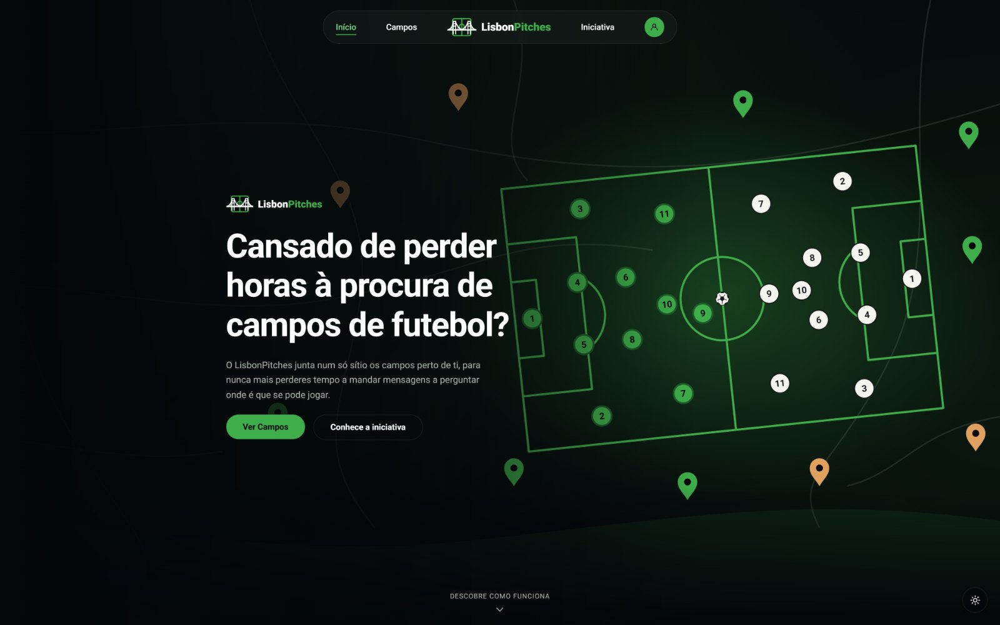

# LisbonPitches

[](https://github.com/simaomonteiro18/LisbonPitches/actions/workflows/ci.yml)

Plataforma de descoberta e reserva de campos de futebol na Área Metropolitana de Lisboa, construída em Java/Spring Boot no backend e React/Vite no frontend.

**53 campos reais catalogados · 17 endpoints REST · 5 entidades · 65 testes (JUnit 5, Mockito, MockMvc, TestRestTemplate)**

🔗 **[API em produção](https://lisbonpitches-production.up.railway.app/pitches)**
— `GET /pitches` devolve uma página de campos (parâmetros `page`, `size` e `sort`, com filtros opcionais por `city`, `name` e `pitchAccess`).



## Foco do projeto

O foco do LisbonPitches é o backend: a API em Java/Spring Boot, o modelo de
domínio, a segurança com JWT e os testes. O frontend em React existe para
demonstrar a API de ponta a ponta. O redesign visual (animações, mapas e
adaptação a telemóvel) foi feito com apoio de IA, a partir das minhas
decisões de produto e de design.

## O que resolve

Encontrar campos de futebol reais na AML — públicos (acesso livre) e
privados (normalmente de clubes ou empresas, pagos) — com morada, mapa,
tipo de jogo e contacto, sem ter de procurar caso a caso. Nos campos que já
suportam reserva online pelo site, também é possível marcar hora e
convidar outros jogadores, com o custo dividido automaticamente por quem
confirmar presença.

### Histórias de utilizador

- **Como jogador**, quero encontrar campos perto de mim, filtrar por
  cidade, nome e se são públicos ou privados, e ver a informação relevante
  (preço, tipo de jogo, contacto) antes de decidir.
- **Como organizador**, quero reservar um campo que suporte reserva
  online, e convidar outros jogadores para essa reserva.
- **Como participante**, quero aceitar convites e saber quanto tenho de
  pagar, com o valor dividido automaticamente por quem confirmou presença.
- **Como jogador interessado num campo privado sem reserva online ainda**,
  quero ver o contacto direto (telefone/email) do campo.

## Dados

**53 campos reais** da Área Metropolitana de Lisboa (Sintra, Amadora,
Oeiras, Loures, Lisboa, entre outros) — aproximadamente 30 privados e 23
públicos — recolhidos manualmente, um a um, sem scraping automático nesta
versão. Cada campo tem tipo (Futebol 5/7/11, Futsal), acesso (público ou
privado) e, quando aplicável, preço, morada, coordenadas, imagem e
contacto. O scope geográfico está limitado à AML por agora; alargar exige
mais campos recolhidos à mão ou submissões de utilizadores.

## Funcionalidades

- **Pesquisa de campos** (`/pitches/todos`) por nome, cidade e acesso
  (público/privado/ambos), entre os 53 campos catalogados.
- **Página de destaque** (`/pitches`) com campos em destaque e um mapa
  interativo de todos os campos, com legenda a distinguir público (verde)
  de privado (laranja).
- **Página de detalhe por campo** (`/pitches/:id`) com morada, tipo, preço
  (quando aplicável), mapa interativo e contacto direto para campos
  privados sem reserva online.
- **Reservas** com validação de sobreposição de horário (ao nível da base
  de dados) e blocos mínimos de 1 hora, convite de outros jogadores e
  divisão automática do custo pelos participantes que aceitaram (incluindo
  o organizador). O pedido de reserva é validado contra a disponibilidade:
  início à hora em ponto, dentro do horário do campo e só em horas livres.
- **Disponibilidade** (`GET /pitches/{id}/availability?date=AAAA-MM-DD`,
  público): devolve as horas de início livres de um campo num dia, a partir
  do horário do campo (dia de semana ou fim de semana), das reservas
  existentes e, se o dia for hoje, das horas que já passaram (hora de
  Lisboa). O estado indica se o campo aceita reservas (`BOOKABLE`,
  `NOT_BOOKABLE`) ou se ainda não tem horário definido (`NO_SCHEDULE`).
- **Autenticação por JWT** (registo/login) com Spring Security aplicado a
  todos os 17 endpoints exceto os públicos (`/pitches`, `/pitches/{id}`,
  `/pitches/{id}/availability`, `/users`, `/login`), sem destaque na
  navegação por agora — ver nota abaixo.
- **Rate limiting no login**: no máximo 5 tentativas falhadas por IP em 15
  minutos; à seguinte a API responde `429 Too Many Requests` com o header
  `Retry-After`. Implementado num filtro (`LoginRateLimitFilter`) com
  contadores em memória (Caffeine), por isso reiniciam num novo deploy.
- **Password forte no registo**: mínimo de 8 caracteres com maiúscula,
  minúscula, número e símbolo, validada no backend (`400` a indicar o que
  falta) e com os requisitos mostrados em tempo real no formulário.
- **Paginação** em `GET /pitches` (`page`, `size`, `sort`), usada na página
  de pesquisa do frontend.
- **CI** no GitHub Actions: os testes correm a cada push (ver o badge no
  topo).
- **Cache** da lista de campos do mapa (`/pitches/map`) com Caffeine, com
  validade de 10 minutos.
- **Sugestão de novos campos**, direto da Home, entregue por email via
  FormSubmit (sem backend próprio).

## Documentação da API

A API está documentada com OpenAPI (springdoc) e pode ser explorada e testada diretamente no Swagger UI:

https://lisbonpitches-production.up.railway.app/swagger-ui.html

Os endpoints protegidos aceitam o token JWT através do botão "Authorize".

### Endpoints

Os endpoints públicos não precisam de token. Todos os outros exigem o
header `Authorization: Bearer <jwt>`, obtido no login.

#### Autenticação e utilizadores

| Método | Endpoint | Descrição | Acesso |
|--------|----------|-----------|--------|
| POST | `/login` | Autenticar e receber o JWT | Público |
| POST | `/users` | Registar um utilizador | Público |
| GET | `/users/{id}` | Resumo de um utilizador | JWT |

#### Campos

| Método | Endpoint | Descrição | Acesso |
|--------|----------|-----------|--------|
| GET | `/pitches` | Página de campos (`page`, `size`, `sort`), com filtros opcionais `city`, `name` e `pitchAccess` | Público |
| GET | `/pitches/{id}` | Detalhe de um campo | Público |
| GET | `/pitches/featured` | Campos em destaque | Público |
| GET | `/pitches/map` | Campos para o mapa (em cache) | Público |
| GET | `/pitches/{id}/availability?date=AAAA-MM-DD` | Horas livres do campo nesse dia (`status` e `freeHours`) | Público |

#### Reservas

| Método | Endpoint | Descrição | Acesso |
|--------|----------|-----------|--------|
| POST | `/reservations` | Criar uma reserva, validada contra a disponibilidade | JWT |
| GET | `/reservations?userId={id}` | Reservas de um utilizador | JWT |
| GET | `/reservations/{id}` | Detalhe de uma reserva | JWT |

#### Convites

| Método | Endpoint | Descrição | Acesso |
|--------|----------|-----------|--------|
| POST | `/invitations` | Convidar um jogador para uma reserva | JWT |
| GET | `/invitations?reservationId={id}` | Convites de uma reserva | JWT |
| GET | `/invitations/me` | Os meus convites | JWT |
| PATCH | `/invitations/{id}/accept` | Aceitar um convite | JWT |
| PATCH | `/invitations/{id}/reject` | Recusar um convite | JWT |
| DELETE | `/invitations/{id}` | Apagar um convite | JWT |

### Nota sobre o login

Registo/login está implementado (Spring Security + JWT, password com
hash BCrypt), mas não tem link em destaque na navegação. É uma decisão
deliberada, não uma funcionalidade em falta: hoje só um campo de
demonstração (InFoot) suporta reserva online de ponta a ponta, por isso
expor login/registo em destaque seria superfície de autenticação sem
benefício real para a maioria dos visitantes. A rota `/login` continua
acessível e funcional; o link volta a aparecer na navegação à medida que
mais campos passarem a suportar reserva online real.

## Stack

**Backend**
- Java 21
- Spring Boot
- Spring Security + JWT
- Spring Data JPA / Hibernate
- Caffeine (cache e rate limiting)
- PostgreSQL (produção) e H2 (desenvolvimento)
- Docker
- JUnit 5, Mockito, MockMvc, TestRestTemplate — 65 testes em 16 classes,
  três camadas (unidade, mocks e integração HTTP, incluindo um teste com
  servidor real)
- Maven

**Frontend**
- React 19
- Vite
- React Router
- Mapbox GL JS (mapas interativos)

## Estrutura do repositório

```
backend/             API em Java/Spring Boot (Maven, Dockerfile)
docs/                diagramas e documentação
frontend/            React/Vite
docker-compose.yml   PostgreSQL e API para desenvolvimento local
```

## Como correr localmente

### Backend (H2, sem dependências externas)

1. Clona o repositório
2. Tens de ter o Java 21 instalado
3. A partir de `backend/`, corre:
   ```
   cd backend
   ./mvnw spring-boot:run
   ```
   (ou abre a pasta `backend/` numa IDE e corre a classe `LisbonPitchesApplication`)
4. O perfil `test` já vem activo por defeito, com H2 em memória e dados de
   exemplo inseridos automaticamente (incluindo os campos reais do
   `pitches-import.csv`)
5. A aplicação sobe em `http://localhost:8080`

### Frontend

1. A partir de `frontend/`, corre `npm install`
2. Cria um `.env` com `VITE_API_URL` (ex.: `http://localhost:8080`) e
   `VITE_MAPBOX_TOKEN` (token público do Mapbox, necessário para os mapas)
3. Corre `npm run dev`
4. A aplicação sobe em `http://localhost:5173`

### Produção (PostgreSQL via Docker)

1. Com o Docker a correr, arranca um container de PostgreSQL:
   ```
   docker run --name lisbonpitches-db -e POSTGRES_PASSWORD=<password> -e POSTGRES_DB=lisbonpitches -p 5433:5432 -v lisbonpitches-data:/var/lib/postgresql/data -d postgres:16
   ```
2. Muda `spring.profiles.active` para `prod` no `backend/src/main/resources/application.properties`
3. Corre a aplicação

## Modelo de domínio


Cinco entidades principais: `User`, `Pitch`, `Reservation`, `Invitation` e
`OpeningHours`, expostas através de 17 endpoints REST e 8 DTOs. O convite
(`Invitation`) é a entidade de ligação entre utilizador e reserva, e guarda
o estado do convite. `Pitch` guarda tipo, acesso (público/privado), morada/coordenadas,
preço, contacto e se suporta reserva online (`reservable`). `OpeningHours`
guarda o horário de abertura de cada campo, por tipo de dia (dia de semana
ou fim de semana).

## Fora do MVP

- **Backoffice** para gerir campos e ver reservas, com autenticação por
  papéis. Campos continuam a vir por seed/csv, não por criação direta de
  utilizadores.
- **Sistema de amigos.** Convites são por username ou email.
- **Notificações.**
- **Pagamentos reais.**
- **App móvel.**
- **Upload de imagem próprio** (imagens vêm de URLs externos por agora).

---

> "Some people think football is a matter of life and death. I don't like that
> attitude. I can assure them it is much more serious than that."
> — Bill Shankly
